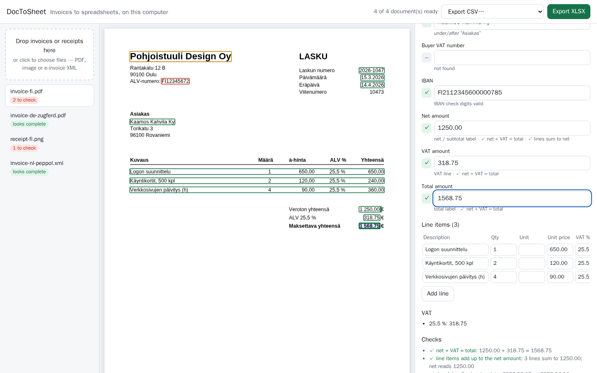

# DocToSheet

**Turn invoices and receipts into a spreadsheet on your own computer — and see exactly where every value came from.**

[](https://github.com/sinceaihq/doctosheet/actions/workflows/ci.yml)
[](https://huggingface.co/spaces/sinceaihq/doctosheet-demo)
[](LICENSE)

Drop in invoices (PDF, scanned PDF, photo, or e-invoice XML), check the values side by side with the document, correct
what is wrong and export a clean Excel or CSV file. No account, no cloud service, no AI API: everything runs locally.

<p align="center">
  
</p>

- **Exact when the invoice allows it.** European e-invoices — Factur-X / ZUGFeRD PDFs, XRechnung, Peppol BIS (UBL)
  and Finvoice — carry their data as XML. DocToSheet reads that data directly: no guessing, no OCR.
- **Transparent when it has to read the page.** For ordinary PDFs it reads the text layer; for scans and photos it uses
  OCR. Every value is linked to the box it was read from, with a confidence mark (✓ / ? / !) and the reasons for it:
  label found, IBAN check digits valid, net + VAT = total, line items add up.
- **Never guesses money.** If an amount is not printed, DocToSheet may *suggest* one (e.g. total = net + VAT) but leaves
  the field empty until you accept it. Suggestions never reach the export by themselves.
- **European formats.** `1.234,56 €`, `1 234,56`, `05.03.2026`, `5. maaliskuuta 2026`, VAT numbers of all EU countries,
  IBANs, invoice vocabulary in about 15 European languages.
- **Spreadsheets that work everywhere.** Amounts are numbers and dates are dates in the XLSX file; CSV comes in two
  flavours (`1234.56` with commas, or `1234,56` with semicolons for European Excel). Text is protected against formula
  injection.

> **Check the results.** On invoices from producers we did not use during development, DocToSheet got totals right
> 97 % of the time but invoice numbers only 22 % and company names 53–61 % (details below). It is a review tool: the
> confidence marks tell you where to look, and nothing here is accounting or tax advice.

## Install

```bash
pip install "doctosheet[ocr] @ git+https://github.com/sinceaihq/doctosheet@v0.1.0"
doctosheet serve
```

`doctosheet serve` opens the review app in your browser at a private address on `127.0.0.1`. Python 3.10 or newer;
Windows, macOS and Linux. Without `[ocr]` everything works except scans and photos. The OCR models (about 20 MB) are
downloaded once, the first time you open a scan, and then run offline.

**Just want to look?** The [web demo](https://huggingface.co/spaces/sinceaihq/doctosheet-demo) runs the same code in your
browser (e-invoice XML and PDFs with text; no OCR).

## Use

1. Drop one or more files on the left, or click to choose them.
2. Each document gets a status: *looks complete* or *N to check*. Click a value to see where it was read; click a box
   on the document to jump to the value.
3. Correct anything that is wrong (your edits are marked as yours), accept or ignore suggestions, mark the document as
   reviewed.
4. **Export XLSX** (sheets: Invoices, Line items, VAT) or **Export CSV**.

From the command line:

```bash
doctosheet extract invoice.pdf                      # summary with confidence marks
doctosheet extract *.pdf -o invoices.xlsx           # batch to Excel
doctosheet extract *.pdf -o lines.csv --table lines --dialect eu
doctosheet extract einvoice.xml --json              # full result with boxes and evidence
```

As a library:

```python
from doctosheet import extract

result = extract(open("invoice.pdf", "rb").read(), "invoice.pdf")
print(result.method)  # "xml", "text" or "ocr"
total = result.fields["total_amount"]
print(total.value, total.confidence, total.evidence, total.box)
for item in result.lines:
    print(item.description.value, item.quantity.value, item.amount.value)
```

## What it reads

| | |
|---|---|
| e-invoices | Factur-X / ZUGFeRD 2.x (CII embedded in PDF/A-3), XRechnung (CII and UBL), Peppol BIS Billing 3.0 (UBL Invoice and CreditNote), Finvoice 3.0 |
| PDFs | text-layer PDFs up to 20 pages; scanned pages are read with OCR |
| images | PNG, JPEG, TIFF, WebP (OCR) |
| header fields | invoice number, invoice and due date, currency, seller, buyer, their VAT numbers, IBAN, net amount, VAT amount, total |
| tables | line items (description, quantity, unit, unit price, VAT rate, amount) from tables with a header row, and receipt-style lines (`2 x Coffee à 3,50  7,00`); VAT breakdown by rate |
| not (yet) | handwriting, multi-currency conversions, discounts and surcharges as separate fields, purchase orders, delivery notes |

## How well does it work?

Two evaluations, both reproducible with the scripts in [`eval/`](eval):

**Independent invoices** — 72 PDF invoices from four producers (symtrax, XML-Rechnung, FNFE, gpFacturX) in the
[ZUGFeRD corpus](https://github.com/ZUGFeRD/corpus), never inspected during development. Each embeds its own EN 16931
XML, which serves as the exact answer; DocToSheet was made to ignore the XML and read the printed page.

<!-- zugferd:start -->
| field | printed PDF (text layer) | same pages as images (OCR) | invoices with this field |
|---|---|---|---|
| invoice number | 22.2 | — | 72 |
| invoice date | 62.5 | — | 72 |
| due date | 82.6 | — | 23 |
| currency | 98.6 | — | 72 |
| seller | 61.1 | — | 72 |
| seller VAT no. | 69.0 | — | 71 |
| buyer | 52.8 | — | 72 |
| buyer VAT no. | 71.4 | — | 14 |
| IBAN | 76.0 | — | 25 |
| net amount | 97.2 | — | 72 |
| VAT amount | 90.3 | — | 72 |
| total amount | 97.2 | — | 72 |
| **all fields** | **72.8** | **—** | |
| values marked ✓ that were correct | 90.5 (of 485) | — | |
<!-- zugferd:end -->

**Synthetic European invoices** — the test split of [EuroDocBench](https://huggingface.co/datasets/sinceaihq/eurodocbench)
(1,200 invoices, 12 locales, 5 layouts).

<!-- edb:start -->
| | text PDFs | simulated scans (OCR) | previous best on the scans |
|---|---|---|---|
| fields correct | 95.7 | — | 67.3 (EasyOCR → Qwen2.5-1.5B) |
| invoices with all 12 fields correct | 75.6 | — | 4.3 |
| values marked ✓ that were correct | 100.0 | — | — |
| line items: invoices with the right number of rows | 97.4 | — | — |
| line items: amounts correct | 97.1 | — | — |
| seconds per invoice (one process) | 0.155 | — | — |
<!-- edb:end -->

What this means: amounts, dates and identifiers next to their labels are read reliably; names and invoice numbers on
unfamiliar layouts often need a correction. The confidence marks are informative but not perfect — on unfamiliar
layouts about one in ten "✓" values was still wrong. Full results, method and limitations:
[docs/EVALUATION.md](docs/EVALUATION.md).

## Privacy and security

- Documents are processed on your computer. The app listens only on `127.0.0.1`, uses a random access token per
  session and refuses requests from other host names; files are kept in memory until you stop it.
- Each file is parsed in a separate process with a time limit and a memory cap; embedded scripts, forms and actions in
  PDFs are never executed; XML is parsed without external entities.
- No telemetry and no network access, except the one-time OCR model download.

See [docs/SECURITY.md](docs/SECURITY.md).

## How it works

```
file ─► sandboxed worker ─► e-invoice XML?  ── yes ─► exact values (source: xml)
                                 │ no
                                 ▼
                     PDF text layer (pdfplumber) ── or ── OCR (RapidOCR, PaddleOCR models)
                                 ▼
               words with boxes ─► lines ─► labels (≈15 languages) ─► fields, tables
                                 ▼
          checks: check digits, net + VAT = total, lines = net, dates ─► confidence
                                 ▼
          review app (pdf.js viewer + form) ─► your corrections ─► XLSX / CSV
```

No machine-learning model decides the values: the extraction is rule-based and every rule leaves evidence. OCR uses
[RapidOCR](https://github.com/RapidAI/RapidOCR) with PaddleOCR's multilingual models. See
[docs/ARCHITECTURE.md](docs/ARCHITECTURE.md).

## Development

```bash
pip install -e ".[ocr,dev]"
pytest                       # unit, server and browser tests (playwright install chromium)
ruff check . && ruff format --check . && mypy
cd ui && npm ci && npm run build      # rebuilds the review app into src/doctosheet/static
python scripts/make_samples.py        # synthetic sample documents in tests/samples
```

## Related Since AI projects

- [EuroDocBench](https://github.com/sinceaihq/eurodocbench) — benchmark for European invoice extraction.
- [SafePrompt](https://github.com/sinceaihq/safeprompt) and [EuroPII Guard](https://github.com/sinceaihq/europii-guard) —
  find personal data before sending text to AI services.

## Licence

Apache-2.0. Uses pdfplumber/pdfminer.six (MIT), pypdfium2 (Apache-2.0/BSD-3), pypdf (BSD), python-stdnum (LGPL),
openpyxl (MIT), RapidOCR and PaddleOCR models (Apache-2.0), pdf.js (Apache-2.0). See [NOTICE](NOTICE).

---

Made by [Since AI](https://sinceai.ai), a non-profit association in Finland. Issues are welcome — especially invoices
DocToSheet reads badly (please replace personal and business details first).
